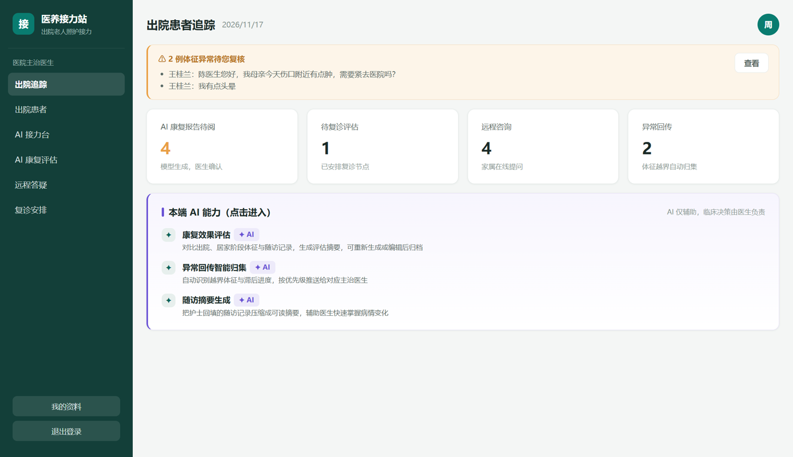
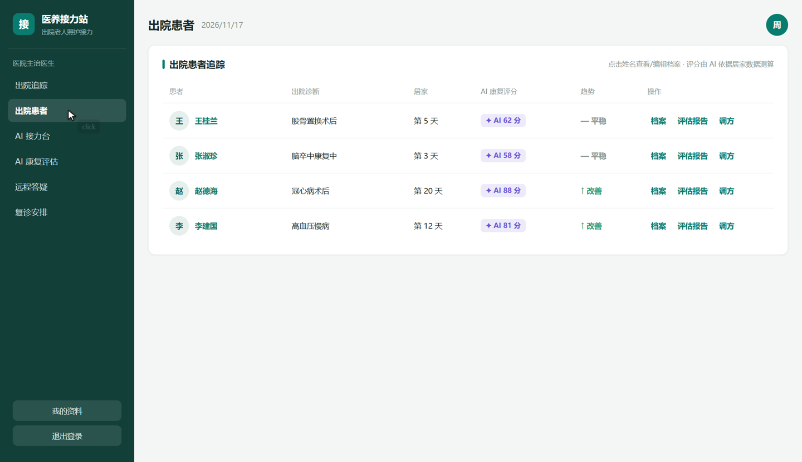
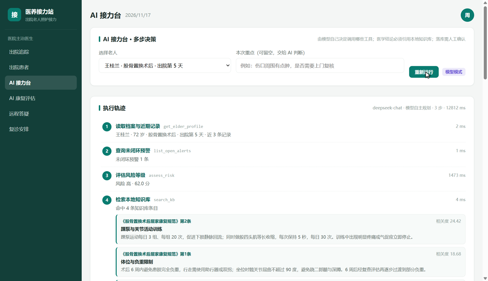
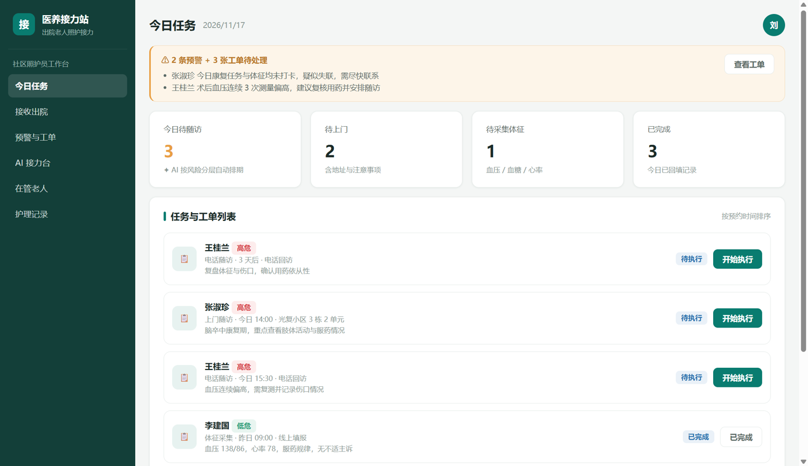
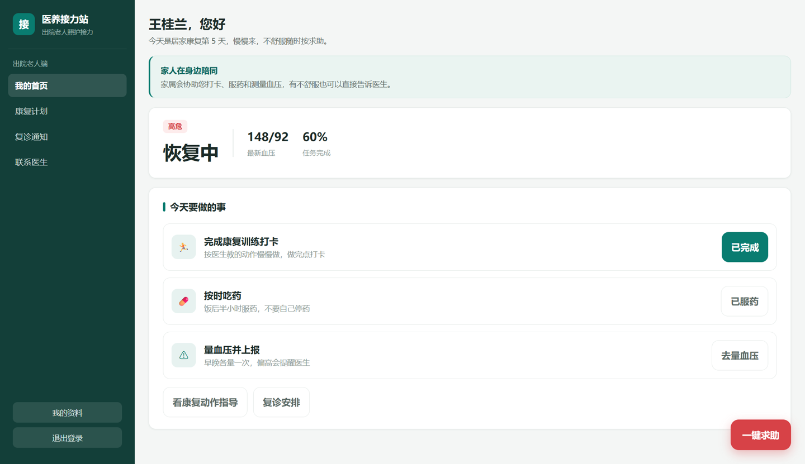
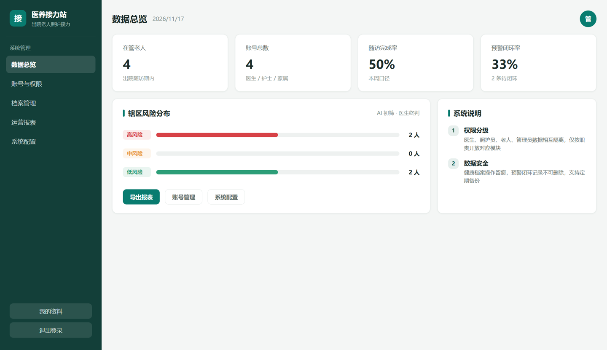
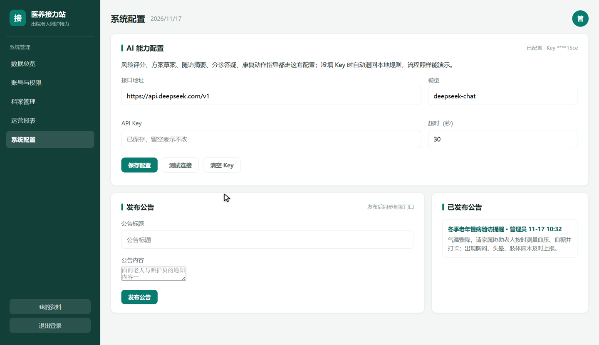

# 医养接力站 · CareRelay

> 面向出院老人的智能康复照护与社区随访系统。
> 第九届「传智杯」全国大学生计算机应用能力大赛 · AI WEB 网页开发挑战赛 参赛作品。

## 描述功能

**出院不是终点，是接力的交接点。** 医院把老人交回社区，中间那段最容易掉链子的 30 天，
系统用一条 AI 接力链把「出院小结 → 照护计划 → 每日打卡 → 随访预警 → 周报复盘」串起来，
让护士把时间花在真正需要人的地方。

## 为什么是这件事

- 我国 60 岁以上人口已超 **3.2 亿**（2025 年末占 23.0%），失能老人约 **3600 万**、失智约 1700 万。
- 老年患者 **30 天再入院率** 的国际参考区间为 **11%–23%**，而其中相当一部分可通过出院后规范随访来避免。
- **39.1%** 的患者存在至少一种用药偏差，其中 **超过 60%** 发生在医院—家庭的护理过渡阶段。
- 政策侧，「互联网+护理服务」自 2019 年六省市试点、2020 年 985 号文推进，社区承接出院后照护已是明确方向。

老人得不到及时的照顾，不在"没有工具"，而在**交接环节信息传递弱**：家属听不懂医嘱、异常发现太晚。

## 界面一览

| 页面 | 截图 |
|---|---|
| 登录（四个演示账号一键填充，注册只开放出院老人） |  |
| 医院主治医生 · 出院追踪（异常横幅 + 四张统计卡） |  |
| 出院患者（风险排序、完成率、出院天数） |  |
| AI 接力台（工具轨迹 + 知识库命中 + 待确认动作） |  |
| 社区照护员 · 今日任务（该管谁、从哪下手） |  |
| 出院老人端（一屏看完今天要做什么） |  |
| 管理员 · 数据总览 |  |
| 管理员 · 系统配置（AI 模型地址、模型名、Key 与连通测试） |  |

## AI 在系统里怎么跑

完整设计见 [`docs/01-AI运行方向说明.md`](docs/01-AI运行方向说明.md)。

| 环 | 时间点 | AI 做什么 | 谁拍板 |
|---|---|---|---|
| 交接环 | 出院 24h 内 | 出院小结 → 结构化档案；风险评分卡 → 30 天计划草案 | **护士签发** |
| 执行环 | 每天 | 打卡内容判读（数值走规则、语音/照片走模型），依从性追踪 | 规则命中即预警 |
| 随访环 | 按风险分层 | 对话 Agent 按脚本采集症状，必要时自动开工单 | 家庭医生处置 |
| 复盘环 | 每周 / 出院 30 天 | 双版本周报（家属白话版 / 医护要点版），再分层 | 护士确认 |

三条技术底线，也是这个项目跟常规做法不同的三处：

1. **数值归代码，语言归模型。** 剂量、阈值、评分一律由代码计算，模型只做抽取与表达，不生成剂量。
2. **结构化优先。** 所有模型输出先过 JSON Schema 校验，校验不过就重试一次，再不过降级到模板。
3. **人在环。** 计划必须护士签发才生效；模型不允许直接改药、下诊断。

## 技术栈

- 后端：Spring Boot 3.3 + Java 21 + MyBatis-Plus + Flyway + MySQL 8
- 前端（当前交付）：`backend/src/main/resources/static/` 下 6 个文件的原生页面 —— `index.html`（登录 / 注册）、`workbench.html`（工作台外壳）、`app.css`、`api.js`、`ui.js`、`views.js`（四端视图与 AI 接力台）。不引框架、不引组件库，打包后随 jar 一起发布，改完刷新即生效。
- 前端（旧版，保留对照）：`frontend/` 下 Vue 3 + Vite + TypeScript + Pinia 的管理端源码，演示包已不再发布这一版，留作改版前后的对照。
- AI：OpenAI 兼容协议（默认 DeepSeek `deepseek-chat`），提示词外置到 `resources/prompts/*.md`，每次调用落 `ai_logs` / `ai_request` 表
- 工程：所有 AI 协作过程记录在 `docs/ai-log/`，与 Git 提交一一对应；后端单测覆盖判读规则、JSON 序列化与角色边界

## 我和 AI 怎么分工

系统由我设计和实现：需求、业务规则、接口和数据模型都由我定，代码主体也是我写的。
AI 在其中承担一部分代码的初稿，比如几个判读函数、页面片段和脚本，改完由我逐段复核后才合并。
改动与验证结论写进 `docs/ai-log/` 对应那一篇（D0–D15，15 篇）。几条实际发生过的分工：

| 环节 | 我做的 | AI 协助的 |
|---|---|---|
| 定范围 | 按 A1–A10 能力清单排优先级，「从零造轮子」的方案第一个被我否掉 | 把候选方案和两档工期估出来 |
| 定规则 | 判定 84 岁独居 + 髋部术后 + 5 种药只给 5 分不合理，要求补照护缺口维度 | 按我的判定改 `HOME_GAP +2`，权重体系不动 |
| 写代码 | 接口与核心逻辑自己实现，再定验收口径：接口断言全绿只算过程，界面能用才算完 | 补若干函数与页面片段，跑单测与 `scripts/api-test.mjs` |
| 找问题 | 逐个页面点开，发现随访气泡只有标签、内容空白 | 照后端真实 JSON 定位到字段名，改 `toTurn()` 映射，我复核 |
| 收尾 | 批准一次提权构建，界面由我本人验收 | 写文档、日志与演示脚本 |

这套分工的完整记录在 [`docs/ai-log/`](docs/ai-log/)，`docs/03-技术文档.md` 第 11 节有归纳。

## 页面

新版只有两个 HTML：`index.html` 管登录注册，`workbench.html` 按角色渲染左侧菜单，切页在 JS 里完成，不整页刷新。下面按「哪个角色用哪块」列。

| 路径 | 给谁看 | 做什么 |
|---|---|---|
| `index.html`（`/`） | 全部角色 | 登录 + 注册两个标签；上方四个角色按钮一键填充演示账号；注册只开放「出院老人」，填完直接建档并绑定 |
| 工作台 · 出院追踪 | 医院主治医生 | 体征异常横幅、四张统计卡（AI 报告待阅 / 待复诊 / 远程咨询 / 异常回传）、按风险排序的在管老人表 |
| 工作台 · 出院患者 | 医院主治医生 | 档案弹窗（诊断、风险分、完成率、近期记录）、评估报告、调方 |
| 工作台 · AI 接力台 | 医院主治医生 / 社区照护员 | 选老人 + 写本次重点，模型自己调工具（读档案 / 查未闭环预警 / 评风险 / 检索知识库 / 起草方案），结论带知识库出处，动作勾选后才写库 |
| 工作台 · AI 康复评估 | 医院主治医生 | 一键生成康复方案草案、随访摘要、分诊建议、康复动作指导 |
| 工作台 · 远程答疑 | 医院主治医生 | 家属 / 老人侧的提问列表与回复 |
| 工作台 · 复诊安排 | 医院主治医生 | 登记复诊、完成复诊（自动排一条「复诊后随访」） |
| 工作台 · 今日任务 / 接收出院 / 预警与工单 / 在管老人 / 护理记录 | 社区照护员 | 该管谁、上门做什么；登记体征（越界自动建预警）；闭环预警需写处置结论 |
| 工作台 · 我的首页 / 康复计划 / 复诊通知 / 联系医生 | 出院老人 | 大字界面的「今天这几件事」；症状短语一键填入聊天框 |
| 工作台 · 数据总览 / 账号与权限 / 档案管理 / 运营报表 / 系统配置 | 管理员 | 统计、停启用账号、新增 / 编辑老人档案、导出 CSV、填 AI 的地址 / 模型 / Key 并测连通 |

## 目录

```
backend/    Spring Boot 服务（开发默认 :8081），四端前端就在 backend/src/main/resources/static/
frontend/   旧版 Vue 3 管理端源码（保留对照，演示包不再发布这一版）
docs/       方向说明、技术文档、指导老师改版说明、AI 协作日志
scripts/    本地起库、起后端、自检与打包脚本
deploy/     docker-compose 与 nginx 配置（留档，演示包不用它）
```

## 怎么跑起来

**演示包（最省事，答辩用这个）**：解压 `医养接力站-演示版-免安装-*.zip`，双击里面的 **`启动演示.cmd`**，等窗口打印「已就绪：http://127.0.0.1:4191」后打开这个地址即可。包内自带 JRE 21、便携 MySQL 8 与预置数据，换一台干净电脑也不用装环境。

**开发模式**：`scripts/db-start.ps1` 起便携 MySQL（3307）→ `scripts/backend-run.ps1` 起后端 → 打开 `http://127.0.0.1:8081`（前端静态页随 jar 一起提供，改完刷新即可，不用单独起前端服务）。

演示账号（登录页点角色按钮会自动填）：

| 角色 | 账号 | 密码 |
|---|---|---|
| 医院主治医生 | `hospital` | `hosp123` |
| 社区照护员 | `nurse` | `nurse123` |
| 出院老人 | `elder1` | `elder123` |
| 管理员 | `admin` | `admin123` |

前置条件（仅开发模式需要）：JDK 21、Maven；演示包不需要任何环境。

## 本地跑起来

> 两个环境限制，踩过才知道，先写在这里：
> 1. **端口**：8080 常被占用，后端默认 8081。
> 2. **数据库路径必须是纯英文**：`mysqld.exe` 会把非 ASCII 路径截断（`D:\学习\...\data` 被读成 `D:\data\`），
>    所以 `db-start.ps1` 把便携 MySQL 放在 `C:\carerelay-mysql-root\cr-mysql`。首次运行会复制约 860MB 并初始化数据目录，只做一次。

```powershell
# 1) 起数据库（便携 MySQL，3307 端口，库名 carerelay）
.\scripts\db-start.ps1

# 2) 起后端（自动打包并运行在 8081）
.\scripts\backend-run.ps1

# 3) 打开 http://127.0.0.1:8081 —— 四端前端随 jar 一起提供，不需要单独构建或起前端服务

# 4) 铺演示数据（走真实接口，产出真实预警/工单/报告/ai_logs）
node scripts/demo-seed.mjs

# 录屏/答辩前想回到完全一样的初始状态，用这一条代替第 4 步：
# .\scripts\demo-reset.ps1
```

**第 5 步：接入模型（可选，但演示建议配）**

1. 浏览器打开 <http://127.0.0.1:8081>，用管理员账号 `admin / admin123` 登录；
2. 左侧点「系统配置」（只有管理员能看到这一项）；
3. 填接口地址（如 `https://api.deepseek.com/v1`）、模型名（如 `deepseek-chat`）、粘贴 API Key；
4. 点「测试连接」——成功会显示模型回的一句话与耗时；再点「保存设置」，**立即生效，不用重启**。

Key 只写本机数据库 `app_setting`，界面上只回显末四位；也可以继续用环境变量 `CR_AI_API_KEY` 启动后端（库里没值时才用环境变量，页面上会写明当前生效的是哪一处）。

> 旧版 Vue 管理端仍可 `cd frontend; npm run dev` 起在 5173（`/api` 由 Vite 代理到 8081），只作对照用。

健康检查：<http://127.0.0.1:8081/api/v1/health>
接口文档：<http://127.0.0.1:8081/swagger-ui.html>

### 验收脚本

```powershell
node scripts\api-test.mjs        # 42 项断言，覆盖鉴权与角色边界、抽取、评分、计划、打卡、预警工单、随访、周报（未配 Key 时 2 项自动跳过）
node scripts\demo-seed.mjs       # 把四个环跑成一条可讲解的故事
.\scripts\demo-reset.ps1         # 清空打卡/预警/工单/随访/周报后重放故事线，结果可复现
```

角色边界由服务端把关（`auth/RoleRules`）：家属可以读今日任务、提交打卡、看周报，
但签发计划、关闭预警、处置工单、触发评估一律 403——前端隐藏按钮只是体验，不是权限。

### 演示账号

| 角色 | 账号 | 密码 |
|---|---|---|
| 医院主治医生 | `hospital` | `hosp123` |
| 社区照护员 | `nurse` | `nurse123` |
| 出院老人 | `elder1` | `elder123` |
| 管理员 | `admin` | `admin123` |

由 Flyway 迁移 `V8__station_module.sql` 写入，`V9` 里删掉了改版初期的 `doctor` 与 `family` 两个测试账号；库里存的是明文口令（演示环境，仅本机使用，不对公网开放）。

### 配置 AI

复制 `.env.example` 为 `.env`，至少填 `CR_AI_API_KEY` 一项即可启用全部模型能力；
向量、视觉、语音三项留空时，系统自动降级为本地检索 / 隐藏该入口，**不填 key 也能把整条业务跑通**
（走 `mode=LOCAL` 的模板兜底，界面上会明确标注"当前为本地模式"）。

## 文档

- [`docs/01-AI运行方向说明.md`](docs/01-AI运行方向说明.md) —— AI 能力清单、关键流程、工程约定、评测与成本（方向文档）
- [`docs/03-技术文档.md`](docs/03-技术文档.md) —— 架构、数据模型、四环实现、AI 工程规范、测试与缺陷复盘（提交用技术文档）
- [`docs/05-提交清单与答辩要点.md`](docs/05-提交清单与答辩要点.md) —— 交什么、自检清单、评审维度对齐、十个答辩问答、已知短板
- `docs/screenshots/` —— 四端八张真实截图（登录 / 出院追踪 / 出院患者 / AI 接力台 / 照护员今日任务 / 老人端 / 数据总览 / 系统配置）；旧版界面截图在 `docs/screenshots/legacy/` 留档
- `docs/ai-log/` —— 每轮 AI 协作的输入、产出、人工改动与验证结论（D0 脚手架 / D1 交接环 / D2 执行环 / D3 随访环 / D4 模型接通与复盘环 / D5 前端与演示数据 / D6 角色边界与验收脚本 / D7 界面走查 / D8 建档表单校验 / D9 人工填写链路 / D10 系统设置与模型接入）

## 赛事说明

- 赛题：第九届传智杯 · 开发类 AI WEB 网页开发挑战赛（团队 1–3 人，需指导教师）
- 提交物：公开仓库 + README + 环境配置说明 + 细粒度 Git 提交历史 + 5–8 分钟讲解视频 + ≤30 页技术文档 PDF
- 本仓库的提交纪律：**一次提交 = 一个功能模块或一轮核心 AI 对话**，禁止攒着一次性提交；
  每轮对话的留痕见 `docs/ai-log/`。

## 进度

> 下面这一节是 11 月初旧版（Vue 管理端 + `/api/v1`）的开发记录，按原样留着当过程证据。
> 改版（四端工作台、AI 接力台与知识库）的说明见 [`docs/06-指导老师改版说明.md`](docs/06-指导老师改版说明.md)。

- [x] 改版：按指导老师意见把前端换成四端（医院主治医生 / 社区照护员 / 出院老人 / 管理员），`/api` 一套新接口，V8–V10 三个迁移建 10 张表 + 40 条知识
- [x] AI 接力台：模型自选工具（读档案 / 查预警 / 评风险 / 检索知识库 / 起草方案），结论带《文档》第 N 条出处，写库前勾选确认
- [x] 演示包：免安装 zip（自带 JRE + MySQL + 预置库），双击启动，4191 打开
- [x] Git 仓库：10 次提交推送到 <https://github.com/saluokede/carerelay>
- [x] 录屏成片 6 分 57 秒（2416×1440，含口播）
- [x] 技术文档：`docs/03-技术文档.md` 重写为赛项结构（17 页 PDF，含 AI 选型理由 / 集成方式 / 优化策略 / 创新点专章）

- [x] 住院记录 ↔ 出院小结关联（按"老人 + 出院日期"自动关联，详情页可一键切到那一份出院小结）
- [x] 住院次数 / 累计住院天数统计（GET /api/v1/admissions/stats，工作台「在管老人」新增「住院」列）
- [x] 住院记录可编辑、可作废（作废不删数据，记原因与时间，写审计；作废在院记录会自动把档案恢复居家）

- [x] 老人档案加「在院状态 / 床号 / 医院 / 科室 / 入院日期」，并在详情页可直接编辑（PATCH /api/v1/elders/{id}，按字段打补丁）
- [x] 住院记录表 `elder_admission`：每次住院一条（医院/科室/床号/入院-出院/原因/天数），同一老人同时只能有一条在院记录
- [x] 详情页「住院记录」卡片：登记住院（可补登历史）、办理出院，档案状态与床位自动联动
- [x] 住院中的老人不参与逾期催办（任务保留、不判 MISSED、不升级预警）；家属端改为"老人在住院中"提示

- [x] 逾期任务自动升级（TaskSweeper，每小时扫一次；手动补跑 POST /api/v1/tasks/sweep，实测 268 条标 MISSED → 4 预警 + 4 工单）
- [x] A4 交接单（/elders/:id/print，独立路由、不套侧栏）
- [x] AI 调用记录页（/ai-records，仅管理员；近 100 次 / 真实模型 90 次 / 中位耗时 1469ms / 失败 0）
- [x] 计划会诊留言（plan_comment 表，医生留言、护士可见，写 PLAN_COMMENT 审计）

- [x] 选题与方向说明文档
- [x] 工程脚手架（认证、异常、Flyway、审计、AI 网关、调用留痕）
- [x] V1 数据库设计（16 张表，覆盖四环）+ 演示账号种子
- [x] 交接环第一步：出院小结 → 结构化档案（JSON 校验、一次纠偏重试、失败降级、调用留痕）
    - 已验证：`POST /api/v1/discharge/extract` 在未配置 Key 时走 `mode=LOCAL` 降级，落库 `extract_status=MANUAL`，`ai_request` 记 `scene=EXTRACT`
    - 已验证（接上 Key 后）：真实抽取 5 种药全抽全（含剂量/频次/途径），给出 `missing_fields` 与逐字段置信度，`mode=MODEL`
- [x] 交接环第二步：风险评分卡（代码算分，9 个评分项）+ 30 天计划草案 + 护士签发 + 每日任务展开
    - 已验证：三位演示老人分别得 4/MEDIUM、7/HIGH、1/LOW；计划 v1 签发后 42 条任务（4 药×7 天 + 血压 + 康复），计划 2 为 56 条、随访间隔 3 天
    - 已验证：`audit_log` 记录 `PLAN_GENERATE` / `PLAN_ISSUE`，签发人落库
- [x] 执行环：每日任务与打卡判读（数值走代码规则、文字走模型+关键词兜底、照片排队目视；预警→工单→处置→审计，一条链走到底）
    - 已验证：182/112 → HIGH；172/104 → MEDIUM；132/82 → NORMAL；"胸口有点闷、出冷汗" → 模型判 ABNORMAL
    - 修过的真问题：客户端只给 `valueJson` 不给 `kind` 时，172/104 会被当成"已完成"静默放过；现在从载荷里读 kind（`CheckinService.submit`）
- [x] 随访环：随访 Agent（按计划间隔排期 → 六问对话 → 结构化记录；红旗自动升级预警+工单）
    - 已验证：六轮推进与 `questionIndex` 语义、否定词抽取（"没有摔倒"不判跌倒）、模型追问、红旗落 `alert_event` + `ticket`
- [x] 复盘环：双版本周报 + 30 天结局 + 护士台总览
    - 已验证：`REPORT_FAMILY` 1482ms / 95 字、`REPORT_CLINICAL` 2976ms / 701 字（均为模型真跑）；修掉 `JsonText` 缺 `JavaTimeModule` 导致周报静默回退模板的缺陷
- [x] 前端八个页面 + 家属端（含大字/高对比），`vue-tsc` 0 错误，`vite build` 109 kB / gzip 42 kB
- [x] 演示数据编排脚本 `scripts/demo-seed.mjs`（四个环跑成一条完整故事）+ `scripts/demo-reset.ps1`（一键复原看板：4 位老人 / 待随访 1 / 预警 3 / 工单 1 / 完成度 29%）
- [x] 角色边界 `auth/RoleRules`（家属越权 403，8 个单测守着）+ 验收脚本 `scripts/api-test.mjs`（配 Key 42/42，不配 Key 40 通过 / 2 跳过）
- [x] 系统设置页 `/settings`（仅管理员）：界面填 Key 即时生效；服务端 `RoleRules.requiresAdmin` 兜底；Key 存库、界面只回显末四位、写审计不记 Key
- [x] 建档表单逐字段校验（必填、手机号格式、出生日期不晚于今天、基础病/过敏不能是纯数字，改一处即时消失）
- [x] 界面走查：八页我在浏览器里逐个点开看，挑出四处：随访气泡字段不一致、列表漏 transcript、家属端空编号无提示、出院日期排序。改法由我定，其中两处映射与提示文案让 AI 出了补丁，其余我自己改，结论记在 `docs/ai-log/` 的 D7
    - 当时截图在 `docs/screenshots/legacy/`（旧版界面的留档）

