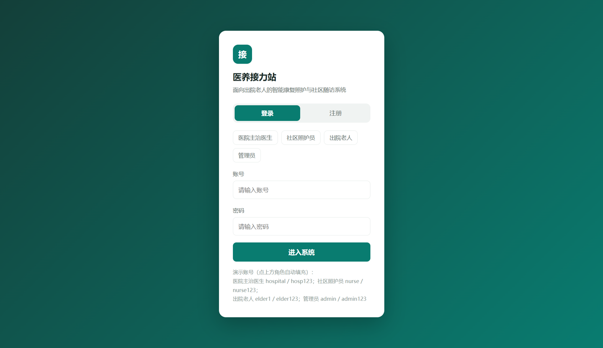
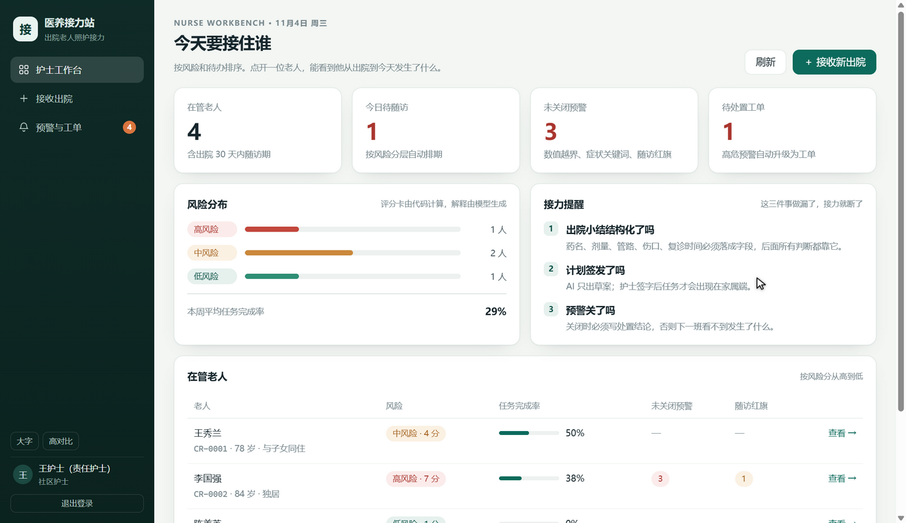
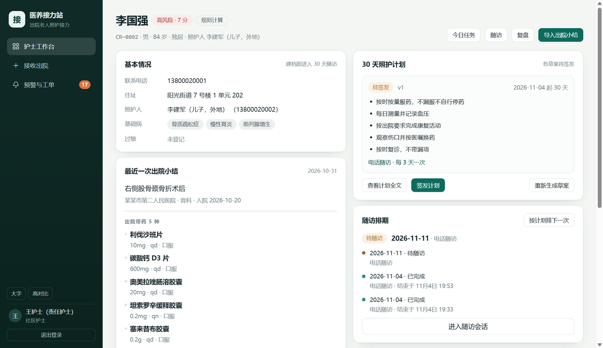
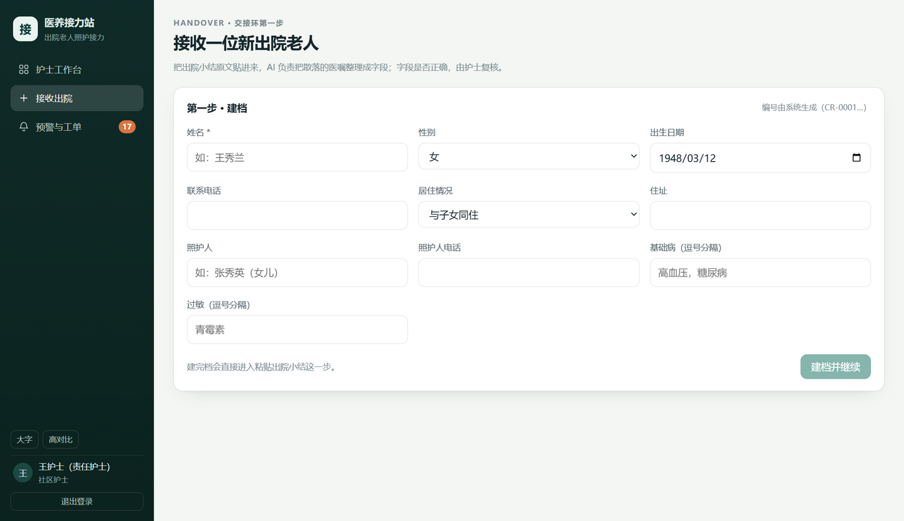
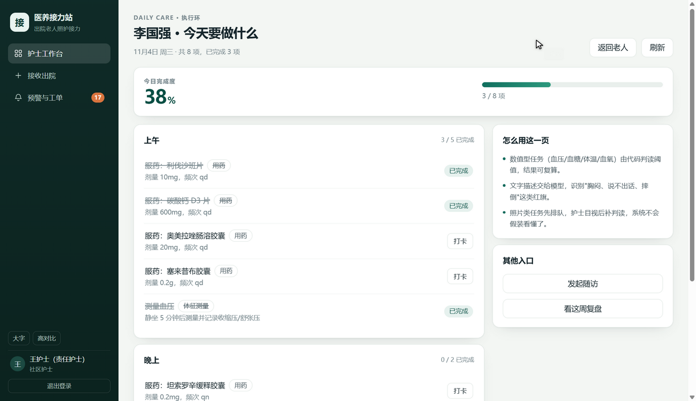
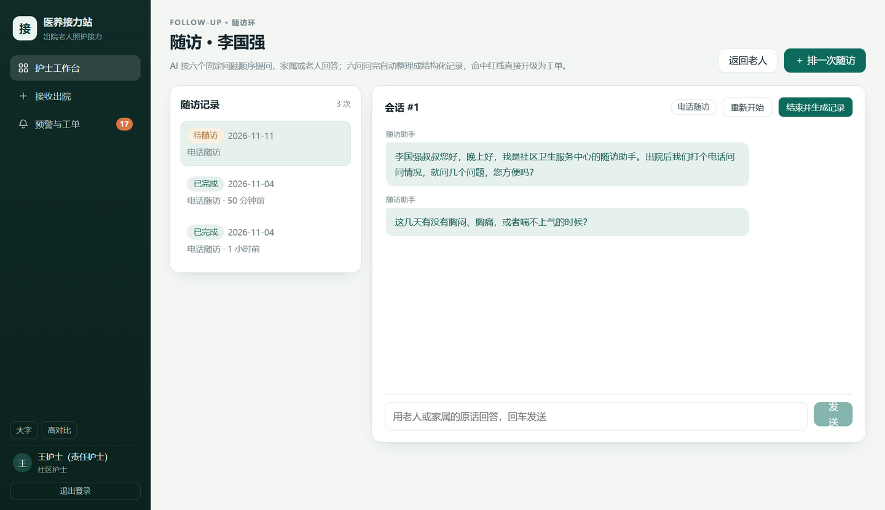
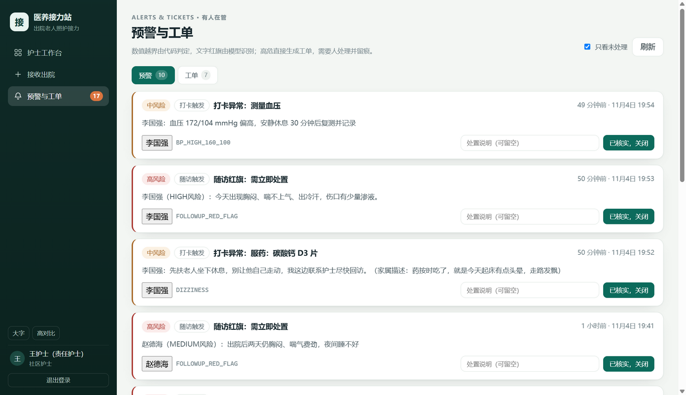
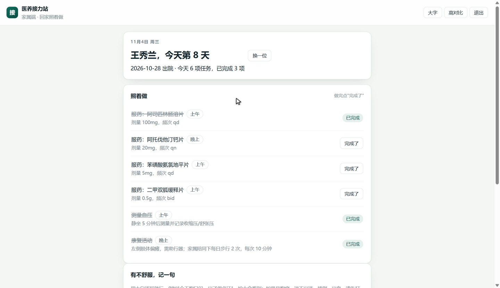

# 医养接力站 · CareRelay

> 面向出院老人的智能康复照护与社区随访系统。
> 第九届「传智杯」全国大学生计算机应用能力大赛 · AI WEB 网页开发挑战赛 参赛作品。

## 一句话

**出院不是终点，是接力的交接点。** 医院把老人交回社区，中间那段最容易掉链子的 30 天，
我们用一条 AI 接力链把「出院小结 → 照护计划 → 每日打卡 → 随访预警 → 周报复盘」串起来，
让护士把时间花在真正需要人的地方。

## 为什么是这件事

- 我国 60 岁以上人口已超 **3.2 亿**（2025 年末占 23.0%），失能老人约 **3600 万**、失智约 1700 万。
- 老年患者 **30 天再入院率** 的国际参考区间为 **11%–23%**，其中相当一部分可通过出院后规范随访避免。
- **39.1%** 的患者存在至少一种用药偏差，其中 **超过 60%** 发生在医院—家庭的护理过渡阶段。
- 政策侧，「互联网+护理服务」自 2019 年六省市试点、2020 年 985 号文推进，社区承接出院后照护已是明确方向。

痛点不在"没有工具"，而在**交接环节的信息断层**：出院小结是自由文本、社区护士靠电话逐个问、
家属听不懂医嘱、异常发现太晚。

## 界面一览

八张截图都是真跑出来的（数据来自 `scripts/demo-seed.mjs`），存在 [`docs/screenshots/`](docs/screenshots)：

| 页面 | 截图 |
|---|---|
| 登录（三个演示账号一键填充） |  |
| 护士工作台（风险分层 + 待办 + 在管老人） |  |
| 老人详情（风险卡 / 计划 / 派药 / 随访排期） |  |
| 接收出院（建档 + 粘贴出院小结） |  |
| 今日任务（按上午/晚上分组，完成度实时） |  |
| 随访对话（六问脚本，红旗自动升级） |  |
| 预警与工单（规则码可追溯） |  |
| 家属端（只做今天这几件事） |  |
## AI 在系统里怎么跑

AI 不是聊天窗口，是**四段接力里的四个角色**。完整设计见 [`docs/01-AI运行方向说明.md`](docs/01-AI运行方向说明.md)。

| 环 | 时间点 | AI 做什么 | 谁拍板 |
|---|---|---|---|
| 交接环 | 出院 24h 内 | 出院小结 → 结构化档案；风险评分卡 → 30 天计划草案 | **护士签发** |
| 执行环 | 每天 | 打卡内容判读（数值走规则、语音/照片走模型），依从性追踪 | 规则命中即预警 |
| 随访环 | 按风险分层 | 对话 Agent 按脚本采集症状，必要时自动开工单 | 家庭医生处置 |
| 复盘环 | 每周 / 出院 30 天 | 双版本周报（家属白话版 / 医护要点版），再分层 | 护士确认 |

三条技术底线，也是本项目的差异化主张：

1. **数值归代码，语言归模型。** 剂量、阈值、评分一律由代码计算，模型只做抽取与表达，不生成剂量。
2. **结构化优先。** 所有模型输出先过 JSON Schema 校验，校验不过就重试一次，再不过降级到模板。
3. **人在环。** 计划必须护士签发才生效；模型不允许直接改药、下诊断。

## 技术栈

- 后端：Spring Boot 3.3 + Java 21 + MyBatis-Plus + Flyway + MySQL 8
- 前端：Vue 3 + Vite + TypeScript + Pinia（**不引组件库**，界面样式全部手写，打包产物 109 kB / gzip 42 kB）
- AI：OpenAI 兼容协议（默认 DeepSeek），提示词外置到 `resources/prompts/*.md`，每次调用落 `ai_request` 表
- 工程：所有 AI 协作过程记录在 `docs/ai-log/`，与 Git 提交一一对应；23 个单元测试覆盖判读规则、JSON 序列化与角色边界

## 页面

| 路径 | 给谁看 | 做什么 |
|---|---|---|
| `/login` | 护士 / 医生 | 演示账号一键填充 |
| `/` 工作台 | 社区护士 | 四个统计卡、风险分布、在管老人表（完成率 / 未关闭预警 / 随访红旗）、接力提醒 |
| `/elders/new`、`/elders/:id/import` | 护士 | 建档（逐字段校验）→ 粘出院小结 → 抽取 → **人工填写 / 修订** → 风险评分卡与计划入口 |
| `/elders/:id` | 护士 | 老人档案、最近出院小结与药单、评分卡因子、30 天计划、随访排期、预警列表 |
| `/elders/:id/plan/:planId` | 护士 | 计划全文 + "任务将这样展开" + 签发 |
| `/elders/:id/today` | 家属 / 护士 | 今日任务打卡：血压两格、血糖体温血氧一格、文字描述触发模型判读 |
| `/elders/:id/followup` | 护士 | 六问对话随访、红案例自动升级工单 |
| `/elders/:id/report` | 护士 / 医生 | 双版本周报（家属版 / 临床版 markdown）+ 30 天结局 |
| `/alerts` | 护士 / 医生 | 预警与工单处置，附处置说明与审计 |
| `/settings` | **仅管理员** | 在界面里填模型地址 / Key / 模型名 / 超时，保存即生效，不用重启 |
| `/family` | 家属 | 输入老人编号（CR-000x）看今日任务、记录一句症状、看本周复盘；支持大字/高对比 |

## 目录

```
backend/    Spring Boot 服务（:8081）
frontend/   Vue 3 前端（构建产物 dist/，演示时用 scripts/serve-frontend.mjs 起 :4173）
docs/       方向说明、开发协议、AI 协作日志
scripts/    本地启动、自检、演示数据编排
deploy/     部署配置
```

## 一键启动（最快）

双击项目根目录的 **`启动.cmd`**：依次拉起 MySQL → 后端 8081 → 前端 4173 → 打开浏览器。
停止：双击 **`停止.cmd`**。

脚本 `scripts/start-all.ps1` 做的事：

1. 调 `scripts/db-start.ps1` 起便携版 MySQL（数据目录固定在 `C:\carerelay-mysql-root`，因为 mysqld 不认中文路径）
2. 以隐藏窗口启动 `backend/target/carerelay-backend-0.1.0-SNAPSHOT.jar`，带 `-Djava.io.tmpdir=<项目>\.tmp\tmp`
3. `frontend/dist` 不存在就先 `npm run build`，再起 `scripts/serve-frontend.mjs`
4. 轮询 `/api/v1/health` 与 4173，就绪后自动打开浏览器

日志在 `.tmp/backend.log`、`.tmp/frontend.log`。登录用 `13800000001 / nurse123`。
前置条件：JDK 21、Node 18+ 已装；jar 已构建过（`cd backend` 后 `mvn -DskipTests package`）。

## 本地跑起来

> 两个环境限制，踩过才知道，先写在这里：
> 1. **端口**：8080 常被占用，后端默认 8081；前端 5173。
> 2. **数据库路径必须是纯英文**：`mysqld.exe` 会把非 ASCII 路径截断（`D:\学习\...\data` 被读成 `D:\data\`），
>    所以 `db-start.ps1` 把便携 MySQL 放在 `C:\carerelay-mysql-root\cr-mysql`。首次运行会复制约 860MB 并初始化数据目录，只做一次。

```powershell
# 1) 起数据库（便携 MySQL，3307 端口，库名 carerelay）
.\scripts\db-start.ps1

# 2) 起后端（自动打包并运行在 8081）
.\scripts\backend-run.ps1

# 3) 构建并托管前端（推荐：静态服务比 dev 稳，录屏不会抖）
cd frontend; npm install; npm run build; cd ..
node scripts/serve-frontend.mjs        # http://127.0.0.1:4173

# 4) 铺演示数据（走真实接口，产出真实预警/工单/报告/ai_request）
node scripts/demo-seed.mjs

# 录屏/答辩前想回到完全一样的初始状态，用这一条代替第 4 步：
# .\scripts\demo-reset.ps1
```

**第 5 步：接入模型（可选，但演示建议配）**

1. 浏览器打开 <http://127.0.0.1:4173>，用管理员账号 `13800000000 / admin123` 登录；
2. 左侧点「系统设置」（只有管理员能看到这一项）；
3. 填接口地址（如 `https://api.deepseek.com/v1`）、模型名（如 `deepseek-chat`）、粘贴 API Key；
4. 点「测试连接」——成功会显示模型回的一句话与耗时；再点「保存设置」，**立即生效，不用重启**。

Key 只写本机数据库 `app_setting`，界面上只回显末四位；也可以继续用环境变量 `CR_AI_API_KEY` 启动后端（库里没值时才用环境变量，页面上会写明当前生效的是哪一处）。

> 前端也可以 `npm run dev` 起在 5173（`/api` 由 Vite 代理到 8081）。

健康检查：<http://127.0.0.1:8081/api/v1/health>
接口文档：<http://127.0.0.1:8081/swagger-ui.html>

### 验收脚本

```powershell
node scripts\api-test.mjs        # 42 项断言，覆盖鉴权与角色边界、抽取、评分、计划、打卡、预警工单、随访、周报（未配 Key 时 2 项自动跳过）
node scripts\demo-seed.mjs       # 把四个环跑成一条可讲解的故事
.\scripts\demo-reset.ps1         # 清空打卡/预警/工单/随访/周报后重放故事线，结果可复现
```

角色边界由服务端把关（`auth/RoleRules`）：家属可以读今日任务、提交打卡、看周报，
但签发计划、关闭预警、处置工单、触发评估一律 403——前端隐藏按钮只是体验，不是权限。

### 演示账号

| 角色 | 手机号 | 密码 |
|---|---|---|
| 中心管理员 | 13800000000 | admin123 |
| 社区护士 | 13800000001 | nurse123 |
| 家庭医生 | 13800000002 | doctor123 |
| 家属 | 13800000003 | family123 |

首次启动时由 `DemoDataSeeder` 自动写入，库里只存 BCrypt 散列。

### 配置 AI

复制 `.env.example` 为 `.env`，至少填 `CR_AI_API_KEY` 一项即可启用全部模型能力；
向量、视觉、语音三项留空时，系统自动降级为本地检索 / 隐藏该入口，**不填 key 也能完整走通业务闭环**
（走 `mode=LOCAL` 的模板兜底，界面上会明确标注"当前为本地模式"）。

## 文档

- [`docs/01-AI运行方向说明.md`](docs/01-AI运行方向说明.md) —— AI 能力清单、关键流程、工程约定、评测与成本（方向文档）
- [`docs/03-技术文档.md`](docs/03-技术文档.md) —— 架构、数据模型、四环实现、AI 工程规范、测试与缺陷复盘（提交用技术文档）
- [`docs/04-演示与录屏脚本.md`](docs/04-演示与录屏脚本.md) —— 6 分 30 秒逐段口播稿与操作顺序
- [`docs/05-提交清单与答辩要点.md`](docs/05-提交清单与答辩要点.md) —— 交什么、自检清单、评审维度对齐、十个答辩问答、已知短板
- `docs/screenshots/` —— 八个页面的真实截图（走查时用浏览器逐个点开拍的）
- `docs/ai-log/` —— 每轮 AI 协作的输入、产出、人工改动与验证结论（D0 脚手架 / D1 交接环 / D2 执行环 / D3 随访环 / D4 模型接通与复盘环 / D5 前端与演示数据 / D6 角色边界与验收脚本 / D7 界面走查 / D8 建档表单校验 / D9 人工填写链路 / D10 系统设置与模型接入）

## 赛事说明

- 赛题：第九届传智杯 · 开发类 AI WEB 网页开发挑战赛（团队 1–3 人，需指导教师）
- 提交物：公开仓库 + README + 环境配置说明 + 细粒度 Git 提交历史 + 5–8 分钟讲解视频 + ≤30 页技术文档 PDF
- 本仓库的提交纪律：**一次提交 = 一个功能模块或一轮核心 AI 对话**，禁止攒着一次性提交；
  每轮对话的留痕见 `docs/ai-log/`。

## 进度

- [x] 住院记录 ↔ 出院小结关联（按"老人 + 出院日期"自动关联，详情页可一键切到那一份出院小结）
- [x] 住院次数 / 累计住院天数统计（GET /api/v1/admissions/stats，工作台「在管老人」新增「住院」列）
- [x] 住院记录可编辑、可作废（作废不删数据，记原因与时间，写审计；作废在院记录会自动把档案恢复居家）

- [x] 老人档案加「在院状态 / 床号 / 医院 / 科室 / 入院日期」，并在详情页可直接编辑（PATCH /api/v1/elders/{id}，按字段打补丁）
- [x] 住院记录表 `elder_admission`：每次住院一条（医院/科室/床号/入院-出院/原因/天数），同一老人同时只能有一条在院记录
- [x] 详情页「住院记录」卡片：登记住院（可补登历史）、办理出院，档案状态与床位自动联动
- [x] 住院中的老人不参与逾期催办（任务保留、不判 MISSED、不升级预警）；家属端改为"老人在住院中"提示

- [x] 逾期任务自动升级（TaskSweeper，每小时扫一次；手动补跑 POST /api/v1/tasks/sweep，实测 268 条标 MISSED → 4 预警 + 4 工单）
- [x] A4 交接单（/elders/:id/print，独立路由、不套侧栏）
- [x] AI 调用记录页（/ai-records，仅管理员；近 100 次 / 真实模型 90 次 / 中位耗时 1469ms / 失败 0）
- [x] 计划会诊留言（plan_comment 表，医生留言、护士可见，写 PLAN_COMMENT 审计）

- [x] 选题与方向说明文档
- [x] 工程脚手架（认证、异常、Flyway、审计、AI 网关、调用留痕）
- [x] V1 数据库设计（16 张表，覆盖四环）+ 演示账号种子
- [x] 交接环第一步：出院小结 → 结构化档案（JSON 校验、一次纠偏重试、失败降级、调用留痕）
    - 已验证：`POST /api/v1/discharge/extract` 在未配置 Key 时走 `mode=LOCAL` 降级，落库 `extract_status=MANUAL`，`ai_request` 记 `scene=EXTRACT`
    - 已验证（接上 Key 后）：真实抽取 5 种药全抽全（含剂量/频次/途径），给出 `missing_fields` 与逐字段置信度，`mode=MODEL`
- [x] 交接环第二步：风险评分卡（代码算分，9 个评分项）+ 30 天计划草案 + 护士签发 + 每日任务展开
    - 已验证：三位演示老人分别得 4/MEDIUM、7/HIGH、1/LOW；计划 v1 签发后 42 条任务（4 药×7 天 + 血压 + 康复），计划 2 为 56 条、随访间隔 3 天
    - 已验证：`audit_log` 记录 `PLAN_GENERATE` / `PLAN_ISSUE`，签发人落库
- [x] 执行环：每日任务与打卡判读（数值走代码规则、文字走模型+关键词兜底、照片排队目视；预警→工单→处置→审计闭环）
    - 已验证：182/112 → HIGH；172/104 → MEDIUM；132/82 → NORMAL；"胸口有点闷、出冷汗" → 模型判 ABNORMAL
    - 修过的真问题：客户端只给 `valueJson` 不给 `kind` 时，172/104 会被当成"已完成"静默放过；现在从载荷里读 kind（`CheckinService.submit`）
- [x] 随访环：随访 Agent（按计划间隔排期 → 六问对话 → 结构化记录；红旗自动升级预警+工单）
    - 已验证：六轮推进与 `questionIndex` 语义、否定词抽取（"没有摔倒"不判跌倒）、模型追问、红旗落 `alert_event` + `ticket`
- [x] 复盘环：双版本周报 + 30 天结局 + 护士台总览
    - 已验证：`REPORT_FAMILY` 1482ms / 95 字、`REPORT_CLINICAL` 2976ms / 701 字（均为模型真跑）；修掉 `JsonText` 缺 `JavaTimeModule` 导致周报静默回退模板的缺陷
- [x] 前端八个页面 + 家属端（含大字/高对比），`vue-tsc` 0 错误，`vite build` 109 kB / gzip 42 kB
- [x] 演示数据编排脚本 `scripts/demo-seed.mjs`（四个环跑成一条完整故事）+ `scripts/demo-reset.ps1`（一键复原看板：4 位老人 / 待随访 1 / 预警 3 / 工单 1 / 完成度 29%）
- [x] 角色边界 `auth/RoleRules`（家属越权 403，8 个单测守着）+ 验收脚本 `scripts/api-test.mjs`（配 Key 42/42，不配 Key 40 通过 / 2 跳过）
- [x] 系统设置页 `/settings`（仅管理员）：界面填 Key 即时生效；服务端 `RoleRules.requiresAdmin` 兜底；Key 存库、界面只回显末四位、写审计不记 Key
- [x] 建档表单逐字段校验（必填、手机号格式、出生日期不晚于今天、基础病/过敏不能是纯数字，改一处即时消失）
- [x] 界面走查：浏览器逐个点开八页，修掉随访气泡字段不一致、列表漏 transcript、家属端空编号无提示、出院日期排序 四处
    - 截图存在 `docs/screenshots/`（登录 → 工作台 → 老人详情 → 今日任务 → 随访 → 预警 → 周报 → 家属端）
- [ ] 录屏（5–8 分钟）、技术文档 PDF（≤30 页）、Git 提交历史
- [ ] 待用户决定：`git init` 与提交节奏（当前仓库尚未初始化 Git）
