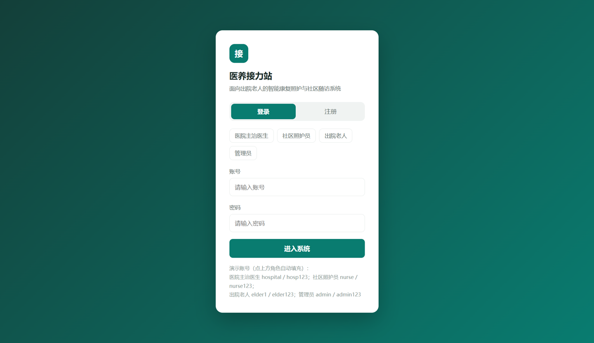
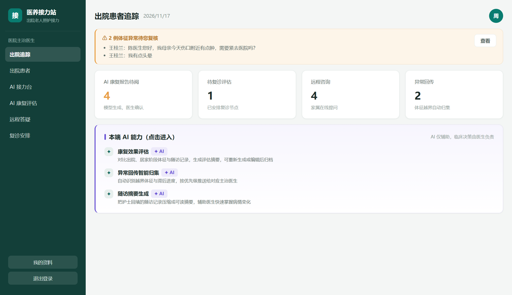
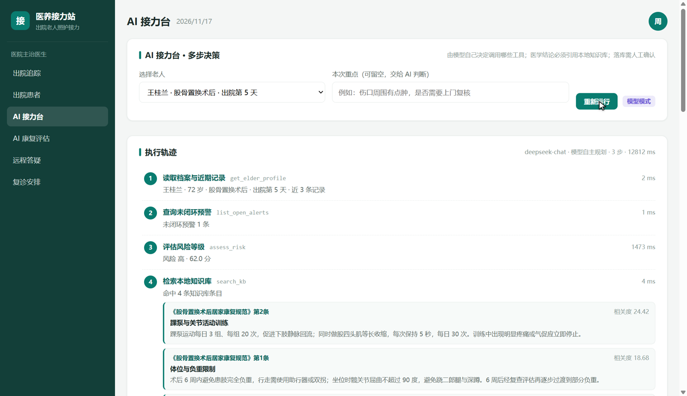
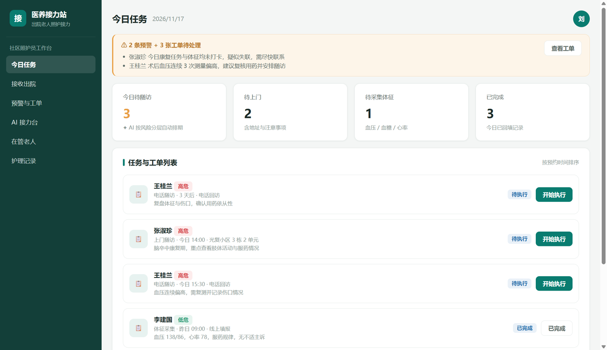
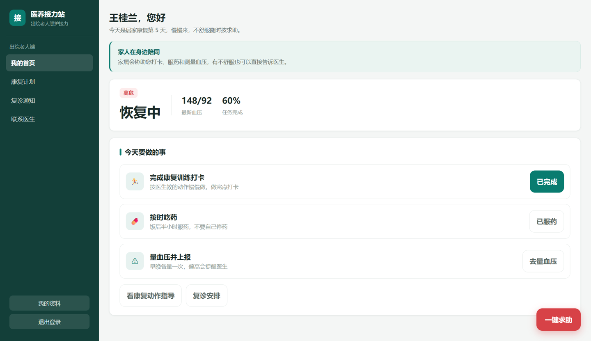
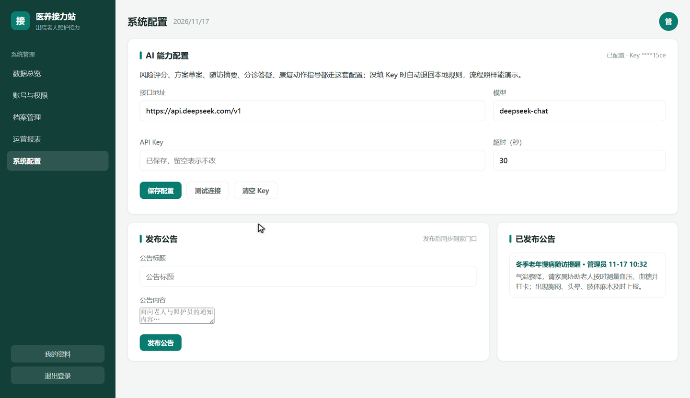

# 医养接力站 · 作品介绍文档

> 第九届「传智杯」全国大学生计算机应用能力大赛 · 开发类 AI WEB 网页开发挑战赛
> 2026 年 11 月 · 仓库 <https://github.com/saluokede/carerelay>

## 一、项目详情与使用方式

医养接力站（CareRelay）是一个面向出院老人的智能康复照护与社区随访系统。它处理的是一个具体的空档：老人出院后，医院把照护责任交给社区和家庭，接下来 30 天里，医嘱没人逐条解释、体征异常发现得晚、随访靠护士一个个打电话。系统要做的，是让这段交接不断档。

**四个角色，四块界面。** 医院主治医生看居家数据、追踪康复效果、签发与调整方案；社区照护员接工单、上门记录、闭环预警；出院老人用大字界面看今天要做什么、给医护留言；管理员管档案、账号、报表和 AI 配置。

**一条主流程**：老人出院 → 医院端在「出院追踪」看到体征异常 → 点开档案核对随访与体征记录 → 在「AI 接力台」让模型读档案、查预警、检索知识库、给出带出处的结论 → 勾选待确认动作写入系统 → 照护员端出现对应工单 → 上门完成后闭环，老人端与家属同步可见。

**使用方式（源码运行）**：装好 JDK 21 与 MySQL 8，建空库 `carerelay`（utf8mb4），用 `backend/` 执行 `mvn -DskipTests package`，再 `java -jar target/carerelay-backend-0.1.0-SNAPSHOT.jar --server.port=8081`，浏览器打开 `http://127.0.0.1:8081`。数据库连接与模型 Key 都通过环境变量传入（`DB_*`、`CR_AI_*`），首次启动 Flyway 自动建表并写入演示数据。作者本机另有免安装包与 `scripts/` 下的便捷脚本，但提交以公开仓库里的源码为准。

**演示账号**（登录页点角色按钮自动填充）：

| 角色 | 账号 | 密码 |
|---|---|---|
| 医院主治医生 | hospital | hosp123 |
| 社区照护员 | nurse | nurse123 |
| 出院老人 | elder1 | elder123 |
| 管理员 | admin | admin123 |

**使用方式（开发）**：`scripts/db-start.ps1` 起便携 MySQL（端口 3307）→ `scripts/backend-run.ps1` 起后端（8081）→ 浏览器打开 `http://127.0.0.1:8081`。前端静态页随 jar 提供，改完刷新即可，不需要单独起前端服务。

## 二、项目亮点

**每条医学建议都能追到出处。** 知识库是随包带的 40 条社区康复与护理规范（股骨置换、脑卒中、冠心病 PCI、高血压、用药安全、伤口识别、预警闭环、营养心理等 8 个主题）。模型写结论前必须调用检索工具，结论里要写出《文档》第 N 条；页面上把命中的原文和相关度一起展开，评审核对时不用猜。

**写库这件事交给人。** AI 给出的动作（签发方案、安排随访、归档评估）在模型侧只是 JSON，页面上勾选并点确认才真正写入。照护员能看完整轨迹，确认按钮是灰的，服务端也校验角色。

**没有 Key 也能演示完整流程。** 未配置模型时自动走本地规则编排（固定 5 步：读档案 → 查未闭环预警 → 检索知识库 → 评风险 → 起草方案），工具轨迹、知识库命中、待确认动作一样不少；填上 Key 后同一页面切换为模型自主规划，两条路共用一份前端渲染逻辑。

**四端共用一条数据链。** 医生的诊断、风险分、任务完成率、未闭环预警是同一行数据；医生确认的动作，照护员的工单列表和老人端的康复计划立刻能看到。

**改版过程看得见。** 从旧版 Vue 管理端到现在的四端界面，每一处改动的原因、验证方式都记录在仓库文档里，包括被否掉的方案与踩过的坑。

## 三、AI 技术落地使用情况

**用的模型与调用方式。** 默认接入 DeepSeek `deepseek-chat`，走 OpenAI 兼容协议，统一由 `AiGateway` 出口（单轮 `chat` 与带工具的多轮 `chatMessage` 两个方法）。配置写在数据库 `app_setting` 表，优先级高于环境变量，管理员在「系统配置」里改完即时生效。

**Agent 工作流。** 「AI 接力台」是一次请求内的多步决策：模型最多 6 轮，根据当前信息决定调用哪个工具——`get_elder_profile`（读档案与近期记录）、`list_open_alerts`（查未闭环预警）、`assess_risk`（重新评分）、`search_kb`（检索知识库）、`draft_rehab_plan`（起草康复方案）。每次工具调用的参数、耗时、命中条目都记进执行轨迹，最终响应带引用列表、结论、发现与待确认动作。

**RAG 的做法。** 没有引入向量库。40 条知识用相邻二字切分 + BM25 排序（k1=1.2，b=0.75），索引 60 秒缓存；实测一句「伤口周围有点肿，是否需要上门复核」能命中《股骨置换术后居家康复规范》第 3 条（相关度 24.42）、《居家伤口与皮肤异常识别规范》第 2 条（13.1）。

**可观测与降级。** 每次 AI 调用写 `ai_logs`：能力名、老人、输出、是否降级（`used_mock`）、提示词版本，以及 Agent 的完整工具轨迹（JSON）。未配置模型时 `used_mock=1`，一眼看出这次是模板还是真模型；JSON 解析失败重试一次后降级，不让页面卡住。

**实测记录。** 真实模型下一次接力台运行 3 步、12.8 秒、6 次知识库命中；规则模式下 5 步、30–99 毫秒、4 条引用。两条路径都能走到「确认执行」，写入后方案表、随访表、记录表各加一行。

## 四、关键技术

**后端**：Spring Boot 3.3 + Java 21 + MySQL 8。旧的 `/api/v1` 业务与新的四端 `/api` 在同一工程内两套拦截器分流——`/api/v1/**` 走原有 `AuthInterceptor` 与角色规则，`/api/**` 走新增的 `StationAuthInterceptor`（解析 JWT、查账号状态、写入请求上下文）。

**数据库**：Flyway 管理迁移。旧版业务表（V1–V7）一张不动，新版按前端需要另建 10 张表（V8–V9）与知识库表（V10），两套并存，回滚只影响一侧。

**权限**：登录态用 JWT；每个写接口在服务端按角色校验（谁能签发方案、谁能闭环预警、谁能停用账号），家属与老人访问非本人档案一律 403。前端把按钮置灰只是体验，服务端不放行才是权限。

**检索**：自研 BM25 检索（中文按相邻二字切分，索引带 TTL 缓存），避免为一个 40 条的语料引入 embedding 模型与向量库。

**工具调用**：提示词约束输出 JSON，`chatMessage` 支持 `tools` + `tool_choice=auto`，模型返回 `tool_calls` 时由服务端执行工具并把结果作为 `role=tool` 消息回填，最多 6 轮。

**前端**：两页静态界面（`index.html` 负责登录注册，`workbench.html` 按角色渲染菜单），6 个文件随 jar 发布，不引组件库。选择原生实现是因为改版只剩一天工期，引入框架的收益低于风险。

**交付**：单体 jar 同时提供静态页与 `/api`，一个进程即可演示；作者本机的免安装包只是把 JRE、MySQL 与代理封在一起，提交材料里不依赖它。

## 五、项目相关图片

登录页：四个角色按钮一点就填好账号，注册只开放出院老人。

医院主治医生端「出院追踪」：顶部横幅直接指向待复核的体征异常，四张统计卡给出待办数量。

AI 接力台：模型自主规划 3 步，第 2 步检索知识库，命中条目带相关度与规范原文。

社区照护员端「今日任务」：按优先级排好的上门与电话随访，右侧是完成状态。

出院老人端：大字界面，症状短语一点就填进输入框。

管理员端「系统配置」：填接口地址、模型、Key，可测连通；Key 只回显末四位。

## 六、是否发表过或获奖

本项目未在任何平台发表过，未参加过其他比赛，也没有获奖记录。它是为本届比赛从零开发的作品，代码托管在 <https://github.com/saluokede/carerelay>（公开仓库，含完整提交历史与开发日志）。

## 七、在既有版本上的优化

本项目确实是在自己早期版本上改的：最初做的是「Vue 管理端 + `/api/v1`」的单机构后台，按指导老师的意见改成了现在的四端界面与 AI 接力台。改了哪些、为什么改，写在下面。

| 方面 | 早期版本 | 现在 |
|---|---|---|
| 前端 | Vue 3 + Vite + TypeScript 单页管理端 | 两页原生界面，6 个文件随 jar 发布，不依赖 npm 构建 |
| 角色 | 护士 / 家庭医生 / 家属 / 管理员 | 医院主治医生 / 社区照护员 / 出院老人 / 管理员 |
| 接口 | `/api/v1`，按旧版页面设计 | 新增 `/api` 一套四端接口，旧接口保留可用 |
| AI 用法 | 每个按钮一次模型调用，代码写死流程 | AI 接力台：模型自选工具、多步执行、结论带知识库出处 |
| 知识来源 | 无知识库 | 40 条社区康复规范，BM25 检索，引用可展开 |
| 写库 | 部分接口直接落库 | 关键动作改为待确认，勾选后写入，角色受控 |
| 交付 | 需要装 JDK 与 MySQL，另起前端 dev server | 单体 jar 同时提供静态页与接口，环境变量配置，一条命令启动 |

改版中还修掉了一些真问题：旧接口的 `ai_request` 留痕字段与新系统不一致（改为 `ai_logs` 并增加 `trace`）、静态资源强缓存导致改完 JS 页面仍是旧的（在引用上加版本号）、便携 MySQL 的数据目录不能含中文（挪到纯英文路径）。
