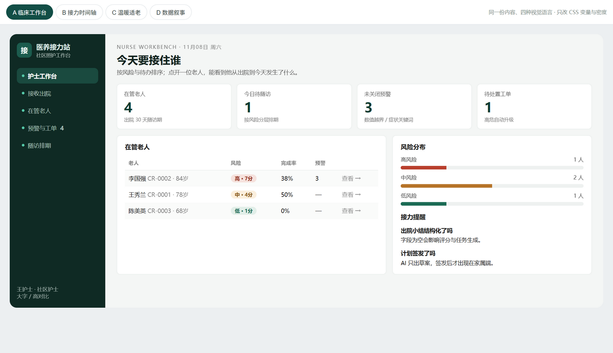
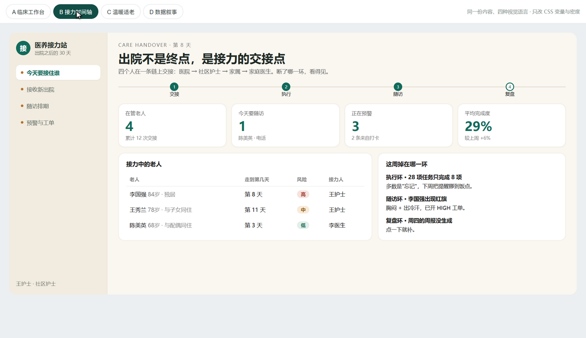
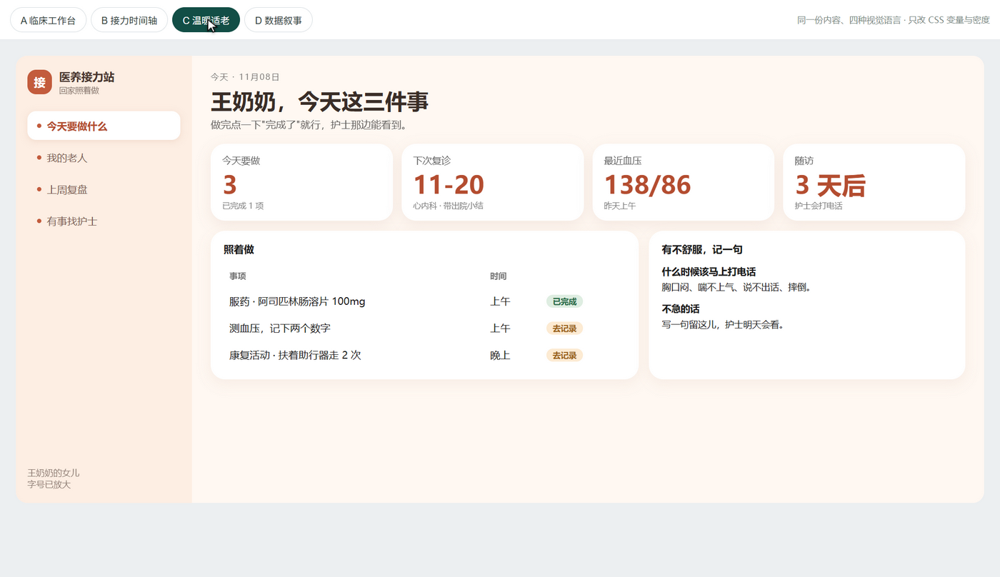
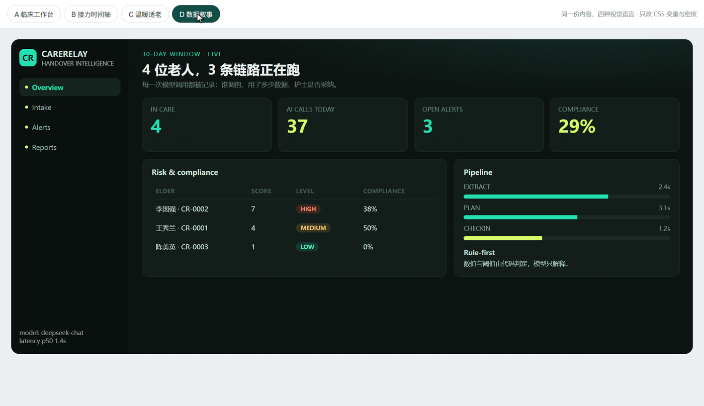

# 前端样貌候选（四选一，先选型再动手）

> 目的：把"重新做一遍视觉"变成"先选一个方向"，避免又返工。
> 四份样貌都是**同一份内容、同一套结构**，只换视觉语言——所以比较的是设计，不是功能。
> 预览文件：`docs/design/样貌预览.html`（浏览器打开，顶部可切换 A/B/C/D）。
> 四张截图也在同目录。
> 分工：需求是我提的——"重新做视觉"，我同时说了现在这版"很难看"；四套样貌的方向和比较口径由我定，预览页、四张截图和这份对比稿由 AI 出初稿，我改定后合并；选哪一套、要不要混，我还没定，所以前端代码一行没动。

---

## 0. 往届获奖作品给了什么信号

我翻了三类公开材料（不追具体作品截图，只取评委口径）：

| 来源 | 关键表述 | 对我们意味着什么 |
|---|---|---|
| [第八届传智杯一等奖（榆林大学）](https://xxgc.yulinu.edu.cn/info/1054/2652.htm) | "将智能交互设计、AIGC 内容生成与轻量化前端架构深度融合，在**功能完整性、技术创新性与用户体验**等维度获认可" | 评委看的是"AI 有没有真的嵌进流程"，不是炫 3D；轻量 = 上线能跑 |
| [第七届传智杯一等奖（成都东软）](https://cs.nsu.edu.cn/2025/E0C15257-1590-451C-9A28-D74E226E1C34.html) | "围绕主题赛道…用 HTML5、小程序、Web 从 0 到 1 按功能迭代" | 叙事要落在一个具体业务闭环上，视觉服务于"讲得清" |
| [赛氪赛道说明](https://www.saikr.com/vse/Webwykf) | "不仅要展现创新的商业理念，还要确保**用户体验流畅、界面美观、功能实用**" | "美观"是明确评分项，但排在"实用"旁边——不能为了好看牺牲信息效率 |

我归纳成四条约束，四份样貌都遵守：

1. **首屏必须一眼看懂"这是给谁用的"**（护士台 / 家属端 / 评审大屏，三种读者不同）。
2. **数字要能被指着讲**：风险分、完成率、预警数必须是大字，不是埋在表格里。
3. **AI 的存在要有痕迹**：模型抽取、判读、周报，要看得见"这一步是 AI 做的、护士改过没有"。
4. **别做模板味**：不要千篇一律的"蓝紫渐变 + 玻璃卡片 + 一堆图标"。

---

## A · 临床工作台（Clinical Console）

**一句话**：像真的社区医院信息系统，克制、密、可信。

| 维度 | 取值 |
|---|---|
| 底色 | 纸灰 `#F4F6F5`，卡片纯白，描边 `#E3E9E6` |
| 主色 | 深林绿 `#0F2A24`（侧栏）/ `#1D5C4E`（强调） |
| 语义色 | 高危 `#B8422A`、中危 `#B5751F`、低危 `#1C6B53` |
| 字体 | 系统黑体；数字用 `tabular-nums` 等宽，30px 起 |
| 圆角 | 8px（克制），阴影几乎不用，靠描边分层 |
| 密度 | 高：表格行高 36–40px，一屏能看 8 行 |

- 适合：护士工作台、预警与工单、计划审阅。
- 加分点：评委里做过企业系统的人一眼认"这是干活的界面"；截图放进技术文档显得专业。
- 风险：**和现在这版最像**——现在这版我说过"很难看"，A 只是把同一种风格做到位，不是解药。
- 改造成本：最低（约半天）。

---

## B · 接力时间轴（Timeline Relay）

**一句话**：把"出院后 30 天"画成一条看得见的接力带，四个人在四个节点交接。

| 维度 | 取值 |
|---|---|
| 底色 | 暖纸 `#FAF7F1`，侧栏 `#F2ECE0` |
| 主色 | 墨绿 `#146B5B`，辅以琥珀 `#B5751F`、砖红 `#A63A2E` |
| 字体 | 标题加粗大字（28px），正文 13px；小标签用全大写 + 字距 |
| 圆角 | 14px，卡片极淡投影（`0 1px 2px rgba(80,60,30,.04)`） |
| 记忆点 | 顶部四节点进度带（交接 → 执行 → 随访 → 复盘）；"这周掉在哪一环"用因果句而不是表格 |

- 适合：登录后的首页、老人详情页顶部、答辩 PPT 的同款视觉。
- 加分点：**最符合赛题名字**——"接力站"这三个字终于在界面上被画出来了；它把"四环"从技术名词变成可讲的故事，答辩时可以直接指着说。
- 风险：纯 B 做护士日常工作台会显得"太文艺"，表格密度不够；需要和 A 的密度混。
- 改造成本：中（约一天，主要是首页与详情页重排）。

---

## C · 温暖适老（Warm Care）

**一句话**：家属端该有的样子——大字号、暖色、只回答"今天做什么"。

| 维度 | 取值 |
|---|---|
| 底色 | 暖米 `#FFF8F2`，侧栏 `#FDEEE2` |
| 主色 | 陶土橙 `#C25E3A` / `#B34F2D`，辅助鼠尾草绿 `#276B45` |
| 字体 | 正文 14–15px 起，关键数字 34px；行高 1.7 |
| 圆角 | 20px，柔和长投影 `0 6px 18px rgba(160,110,80,.10)` |
| 记忆点 | 一屏只有三件事 + 一句"什么时候该马上打电话" |

- 适合：家属端（`/family`）、老人卡片、大字/高对比模式的默认态。
- 加分点：评审看到"给 78 岁老人家属用的界面"会立刻理解适老设计；也是答辩里"人文关怀"的实证。
- 风险：**不适合给护士用**——信息密度太低，护士要一屏看完 20 条待办；全站用 C 会让作品显得"像个 App Demo"。
- 改造成本：低（家属端本来就是独立布局，约半天）。

---

## D · 数据叙事（Data Narrative）

**一句话**：深色路演大屏，把"AI 真的在跑"可视化：调用次数、延迟、采纳率。

| 维度 | 取值 |
|---|---|
| 底色 | 近黑墨绿 `#0D1412`，卡片 `#131E1B`，描边 `#21332D` |
| 主色 | 荧光薄荷 `#29E0B0`，点缀柠檬 `#D6FF5C` |
| 字体 | 全大写小标签 + 字距 1.6px；数字 34px 荧光色 |
| 圆角 | 12px；细描边代替阴影；背景一层径向光晕 |
| 记忆点 | "AI CALLS TODAY 37 · adopted 82%" 这种只有真系统才拿得出的数 |

- 适合：`/settings` 之外的"关于这套 AI 怎么跑"的展示页、答辩开场 30 秒。
- 加分点：视觉冲击最强，适合录屏封面和 PPT 首图；深色截图在投影仪上更清楚。
- 风险：**医疗场景用深色容易被读成"监控/风控"，而不是"照护"**；长期看也伤眼睛，不适合护士连续用 6 小时。
- 改造成本：中（只做一个展示页最划算，全站改造成本高、风险大）。

---

## 建议：B 做骨架，A 做密度，C 做家属端，D 只做一页

这套建议是 AI 提的，是否按这个分工走、先落哪块由我定。不是四选一，而是**按角色分工**——这也是真实产品会做的事：

| 区域 | 用哪套 | 理由 |
|---|---|---|
| 登录 / 首页 / 老人详情 | **B 接力时间轴** | 赛题叫"接力站"，首页就要把四环画出来；答辩第一屏就赢在"讲得清" |
| 工作台表格 / 预警工单 / 计划审阅 | **A 的密度**套 B 的配色 | 护士要一屏看完待办，B 的暖纸底色 + A 的紧凑表格可以共存 |
| 家属端 | **C 温暖适老** | 独立布局，本来就该和护士端长得不一样 |
| 一页"AI 运行概览"（可选） | **D 数据叙事** | 把 `ai_request` 表可视化，作为技术文档封面 / 录屏开场 |

**代价评估**：只改 `global.css` 的设计变量 + 三个布局壳（AppLayout / FamilyLayout / 登录页），页面结构基本不动，约 **1 天**；如果连页面结构也重排（B 的首页、C 的家属端），约 **2 天**。两档工期同样是 AI 估的，采不采、怎么混由我拍板。

---

## 需要定的一件事

定一个方向就行：

- `A` / `B` / `C` / `D` —— 只要一个方向；
- 或者 `混合`（AI 上面建议的：B 骨 + A 密度 + C 家属端 + D 一页）；
- 或者说明"哪张最想要、哪张最不要"，AI 据此再出一版。

定下来之前我不让 AI 动代码，到现在一行前端都没改。
